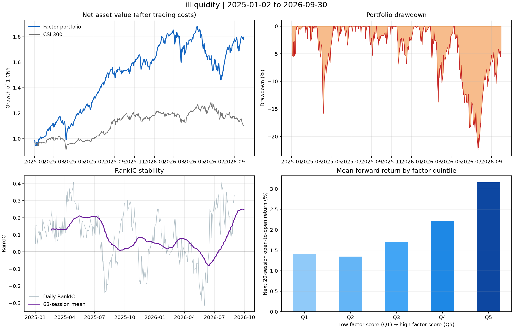
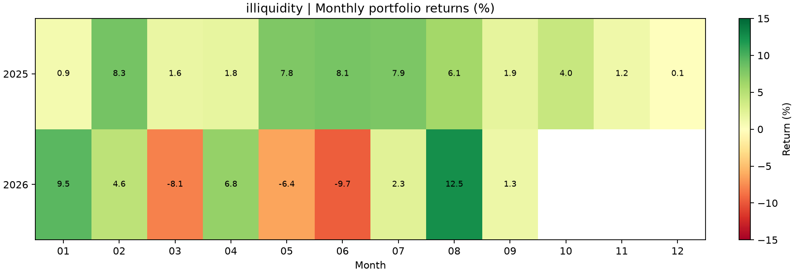
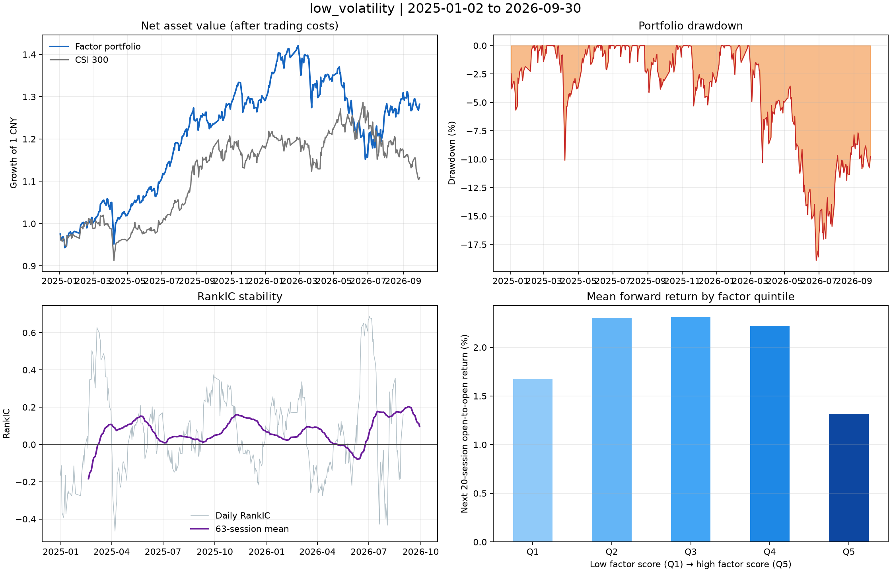
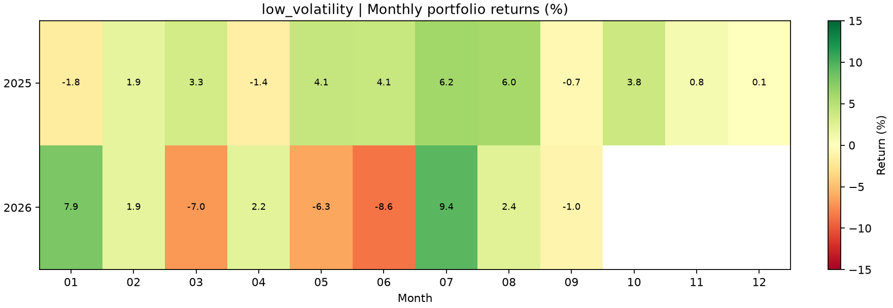
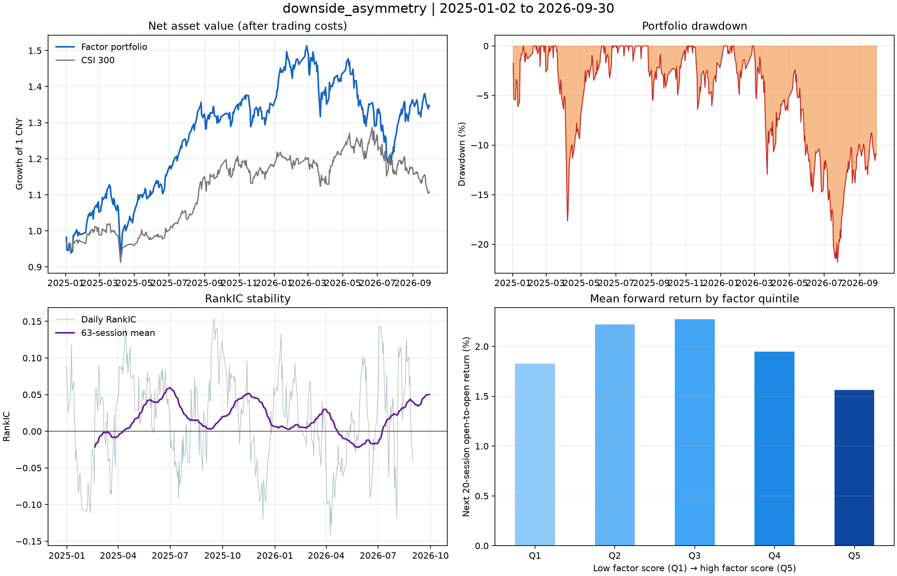
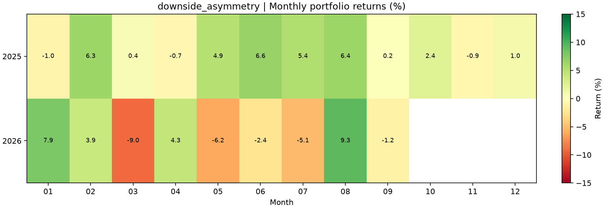
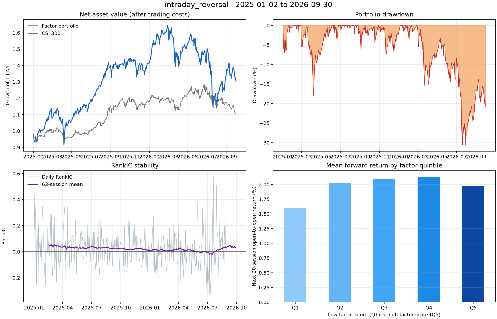
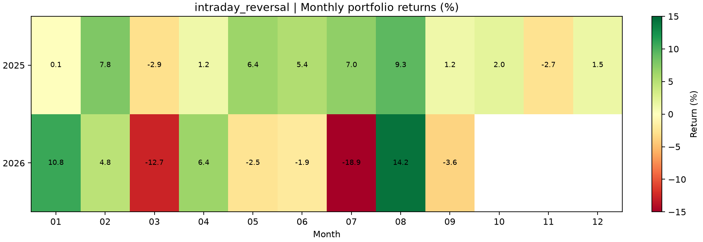

# 单因子评价结果

| 因子 | 年化收益 | Sharpe | 最大回撤 | RankIC均值 | RankICIR | Q5-Q1未来20日 | 平均换手 |
| --- | --- | --- | --- | --- | --- | --- | --- |
| 非流动性 / 价格冲击 | 41.46% | 1.5705 | 22.41% | 0.0903 | 0.6046 | 1.75% | 9.23% |
| 低波动 | 15.92% | 0.9709 | 18.90% | 0.0664 | 0.2881 | -0.36% | 14.68% |
| 收益偏度 | 19.34% | 0.9224 | 21.82% | 0.0185 | 0.3062 | -0.27% | 32.42% |
| 日内反转 | 17.10% | 0.7087 | 30.67% | 0.0230 | 0.1672 | 0.38% | 156.64% |

## 年度收益

| 年份 | 非流动性 / 价格冲击 | 低波动 | 收益偏度 | 日内反转 |
| --- | --- | --- | --- | --- |
| 2025 | 61.80% | 29.20% | 34.98% | 41.69% |
| 2026 | 10.78% | -0.76% | -0.24% | -7.96% |

## 因子诊断

### 非流动性 / 价格冲击

#### 组合与预测指标

| 指标 | 数值 |
| --- | ---: |
| 累计收益 | 79.2433% |
| 年化波动率 | 23.9555% |
| Sortino 比率 | 2.1159 |
| Calmar 比率 | 1.8497 |
| 信息比率 | 1.4701 |
| 相对基准超额收益 | 61.7288% |
| 日胜率 | 58.0189% |
| IC均值 | 0.0529 |
| ICIR | 0.5024 |
| IC HAC t统计 | 2.6497 |
| RankIC HAC t统计 | 3.1889 |
| IC正值比例 | 67.9245% |
| RankIC正值比例 | 70.9906% |
| Q1未来20日收益 | 1.4067% |
| Q2未来20日收益 | 1.3482% |
| Q3未来20日收益 | 1.6999% |
| Q4未来20日收益 | 2.2128% |
| Q5未来20日收益 | 3.1615% |
| Q5-Q1正收益比例 | 63.6792% |
| 沪深300 Beta | 0.7716 |
| 年化Alpha估计 | 0.3180 |
| 日VaR 95% | -0.0235 |
| 日CVaR 95% | -0.0351 |
| 日收益偏度 | -1.7609 |
| 日收益超额峰度 | 12.6996 |
| 平均仓位 | 0.9977 |
| 累计佣金 | 5,870,089.86 |
| 累计印花税 | 14,868,412.71 |

#### 净值、回撤、IC 与分层表现

#### 月收益热力图

### 低波动

#### 组合与预测指标

| 指标 | 数值 |
| --- | ---: |
| 累计收益 | 28.2185% |
| 年化波动率 | 16.6692% |
| Sortino 比率 | 1.2616 |
| Calmar 比率 | 0.8423 |
| 信息比率 | 0.5538 |
| 相对基准超额收益 | 15.6898% |
| 日胜率 | 57.5472% |
| IC均值 | 0.0131 |
| ICIR | 0.0650 |
| IC HAC t统计 | 0.3816 |
| RankIC HAC t统计 | 1.7059 |
| IC正值比例 | 43.3962% |
| RankIC正值比例 | 54.2453% |
| Q1未来20日收益 | 1.6742% |
| Q2未来20日收益 | 2.3026% |
| Q3未来20日收益 | 2.3141% |
| Q4未来20日收益 | 2.2224% |
| Q5未来20日收益 | 1.3170% |
| Q5-Q1正收益比例 | 39.6226% |
| 沪深300 Beta | 0.5605 |
| 年化Alpha估计 | 0.1195 |
| 日VaR 95% | -0.0160 |
| 日CVaR 95% | -0.0250 |
| 日收益偏度 | -2.0869 |
| 日收益超额峰度 | 15.8818 |
| 平均仓位 | 0.9976 |
| 累计佣金 | 7,514,898.06 |
| 累计印花税 | 18,863,748.38 |

#### 净值、回撤、IC 与分层表现

#### 月收益热力图

### 收益偏度

#### 组合与预测指标

| 指标 | 数值 |
| --- | ---: |
| 累计收益 | 34.6518% |
| 年化波动率 | 21.8024% |
| Sortino 比率 | 1.1922 |
| Calmar 比率 | 0.8866 |
| 信息比率 | 0.8012 |
| 相对基准超额收益 | 21.4944% |
| 日胜率 | 57.0755% |
| IC均值 | -0.0025 |
| ICIR | -0.0505 |
| IC HAC t统计 | -0.3177 |
| RankIC HAC t统计 | 2.0453 |
| IC正值比例 | 45.7547% |
| RankIC正值比例 | 59.6698% |
| Q1未来20日收益 | 1.8275% |
| Q2未来20日收益 | 2.2193% |
| Q3未来20日收益 | 2.2748% |
| Q4未来20日收益 | 1.9468% |
| Q5未来20日收益 | 1.5621% |
| Q5-Q1正收益比例 | 42.6887% |
| 沪深300 Beta | 0.9014 |
| 年化Alpha估计 | 0.1331 |
| 日VaR 95% | -0.0210 |
| 日CVaR 95% | -0.0334 |
| 日收益偏度 | -2.1692 |
| 日收益超额峰度 | 16.8334 |
| 平均仓位 | 0.9977 |
| 累计佣金 | 17,356,374.93 |
| 累计印花税 | 43,484,004.22 |

#### 净值、回撤、IC 与分层表现

#### 月收益热力图

### 日内反转

#### 组合与预测指标

| 指标 | 数值 |
| --- | ---: |
| 累计收益 | 30.4177% |
| 年化波动率 | 27.7951% |
| Sortino 比率 | 0.9417 |
| Calmar 比率 | 0.5575 |
| 信息比率 | 0.6071 |
| 相对基准超额收益 | 17.6740% |
| 日胜率 | 55.6604% |
| IC均值 | 0.0174 |
| ICIR | 0.1506 |
| IC HAC t统计 | 2.4505 |
| RankIC HAC t统计 | 3.9617 |
| IC正值比例 | 55.1887% |
| RankIC正值比例 | 53.5377% |
| Q1未来20日收益 | 1.6035% |
| Q2未来20日收益 | 2.0229% |
| Q3未来20日收益 | 2.0913% |
| Q4未来20日收益 | 2.1319% |
| Q5未来20日收益 | 1.9803% |
| Q5-Q1正收益比例 | 50.7075% |
| 沪深300 Beta | 1.1507 |
| 年化Alpha估计 | 0.1101 |
| 日VaR 95% | -0.0264 |
| 日CVaR 95% | -0.0436 |
| 日收益偏度 | -1.1663 |
| 日收益超额峰度 | 6.5402 |
| 平均仓位 | 0.9977 |
| 累计佣金 | 87,595,538.62 |
| 累计印花税 | 219,138,736.93 |

#### 净值、回撤、IC 与分层表现

#### 月收益热力图

分层收益为重叠的未来 20 日开盘到开盘诊断值，不用于 Sharpe 年化；Sharpe 等组合指标来自逐日真实撮合回测，含手续费。HAC t 统计采用最多 20 阶 Newey-West 修正。VaR/CVaR 使用历史日收益分位数。
